<div align="center">

# ATLAS

### Audit-Tracked Lineage and Adaptive Selective Recovery

**Undo one bad change — and only that change — after it has already spread through your data.**


[What it does](#what-it-does) · [Results](#measured-results-synthetic-data) · [Screenshots](#screenshots) ·
[How it works](#how-pascar-recovery-works) · [Architecture](#architecture) · [Run it](#run-it) ·
[Verification](#what-has-been-verified--and-what-has-not) · [Docs](#documentation)

</div>

---

## The problem

Someone types a product price as **₹500 instead of ₹5,000**. Before anyone notices, that price has been
copied into order lines, summed into order totals, invoiced, and some of those invoices have been issued
to customers. Meanwhile people kept working: they edited delivery notes, re-priced lines, created new orders.

The usual fix is a **point-in-time restore** — which also throws away every legitimate change made since.
Following foreign keys instead touches records that never used the wrong price. Neither tells you which
records are *actually* wrong, nor what to do about the invoices that legally cannot be edited.

**ATLAS finds exactly the records that consumed the faulty value, plans an ordered field-level correction,
sends real conflicts to a person, requires a separate approver, executes with version checks, compensates
issued invoices with credit notes, verifies the result — and never erases history.**

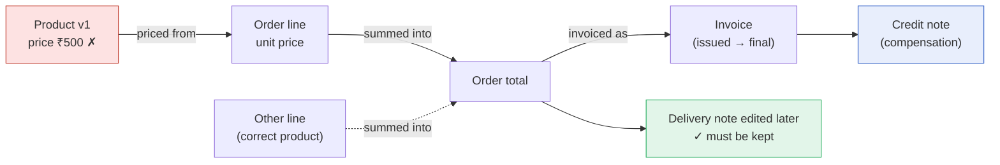

---

## What it does

| | Capability | Details |
|---|---|---|
| 🧬 | **Field-level provenance, recorded at write time** | Every derived value stores *which field of which version* it came from, in the same transaction as the business write. Each edge is graded **Verified / Declared / Inferred**; required inputs that were never recorded are reported as **gaps**. |
| 🎯 | **PASCAR selective recovery** | Provenance-Aware Selective Conflict-Aware Recovery: taint analysis over versions, iterative Tarjan for cycles, a dependency-ordered plan, credit-note compensation for final documents, invariants and a plan fingerprint. |
| ⚖️ | **Per-field temporal conflicts** | 7 conflict kinds (same field changed later, different field changed later, re-derived from another source, changed after planning, unknown origin, …). Unreviewed conflicts **block execution**; reviews are append-only. |
| 🧪 | **Counterfactual simulation of 6 strategies** | Point-in-time restore, FK whole-row, version whole-row, FK field-level, provenance without conflicts, and PASCAR — all replayed on an isolated in-memory copy of one REPEATABLE READ snapshot. Nothing in the database changes. |
| 📐 | **Constraint-based optimizer and explained risk** | 8 hard constraints (no collateral, keep later updates, no deletions, version-checked writes, conflicts go to people, …), a scored ranking among feasible strategies, and a LOW→CRITICAL risk level with the factors behind it. |
| 🔐 | **Governed execution** | Author ≠ approver, approval bound to the plan fingerprint, stale-plan checks, one transaction per step, crash-safe resume, idempotent replay, 7 kinds of post-execution verification. |
| 🧾 | **Tamper-evident history** | Append-only change events, SHA-256 hash-chained per tenant by the database, plus **Ed25519-signed anchors kept outside the database** that catch even a superuser rewrite. |
| 🩺 | **Continuous integrity monitoring** | Versioned rules (order totals, invoice totals, derived values, required provenance, audit chain), scheduled and on-demand runs, de-duplicated findings that clear themselves. Checks only *read*. |
| 🕸️ | **Graph Intelligence** | Live **ER diagram** generated from PostgreSQL's catalog (platform-admin only, every access audited), multi-hop **lineage graph** on React Flow + ELK with progressive expansion, and record-level **strategy comparisons** stored as immutable, hashed artifacts. |
| 🏢 | **Multi-tenant commerce domain** | Organizations, roles and permissions, catalogue, customers, orders, invoices, credit notes, gapless document numbers, optimistic locking with ETags, idempotency keys. |

---

## Measured results (synthetic data)

All numbers below were measured by scripts in this repository on **generated, clearly labelled synthetic
data**. Raw outputs are committed next to each report.

| Experiment | Scale | Result |
|---|---|---|
| **Impact analysis vs an independent oracle** ([report](docs/experiments/phase5-impact-analysis.md)) | up to 100,000 orders, 18 runs | PASCAR precision **1.000** and recall **1.000** in every run; plan totals and credit amounts matched the oracle for **137,509 orders** and **25,030 invoices**. 30–60 % of records chosen by naive FK traversal were never affected. |
| **End-to-end on PostgreSQL** ([report](docs/experiments/phase7-benchmark.md)) | up to 100,000 orders / 850,000 versions, 21 runs | Exact record selection through the application's own SQL; **0** records written outside the truth; every total consistent afterwards; **90/90** concurrent edits detected and never overwritten. A point-in-time restore would have rewound up to **310,605** records of legitimate work. |
| **Six strategies, one snapshot** ([report](docs/experiments/atlasx-milestone8.md)) | 36 runs, up to 20,000 orders | Only conflict-aware PASCAR met **every** hard constraint in **every** run — no collateral, no later edit lost, nothing deleted, all **822** conflicts sent to a person. Ignoring conflicts repaired more automatically (97.3 % vs 91.2 %) but broke **794** totals. |
| **Hardening** ([report](docs/security/hardening.md)) | 850,000 versions | Two indexes: audit time-window list **174 ms → 0.13 ms**, invoice list **7.5 ms → 0.04 ms**. Signed external anchors caught a history rewrite the in-database check accepted. |

**Bugs the experiments found — and fixed:**
- planning was quadratic (**129 s → 3 s** at 100k orders);
- execution re-read the plan on every step (**97 ms → 0.5 ms** per lock);
- simulation was quadratic (**9 s → 0.12 s** at 2,000 orders, identical results);
- a total could disagree with its lines while one line waited for review (fixed with consistency groups shared by the simulator and the executor).

> With 10 % of provenance edges deliberately removed, recall drops to about 0.85. PASCAR is only as complete
> as its instrumentation — which is exactly why ATLAS reports gaps and refuses to call an unreached record
> "verified unaffected" (it says `NOT_REACHED_PROVENANCE_COMPLETE` or `…_INCOMPLETE` instead).

---

## Screenshots

| | |
|---|---|
| 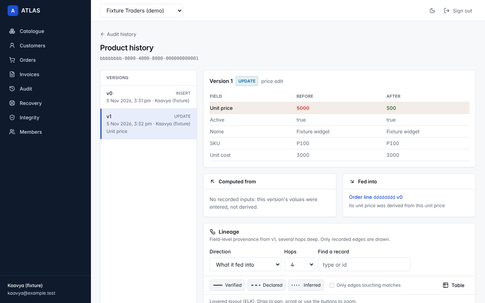 **A faulty version and everything it fed into** | 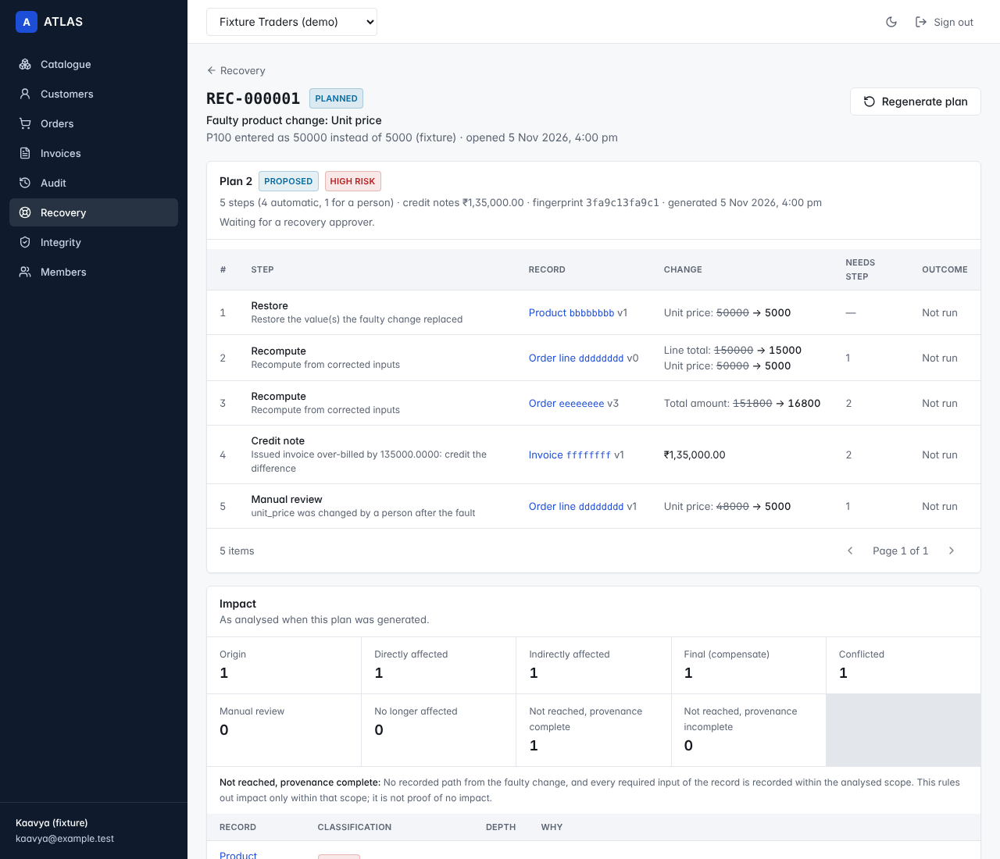 **A recovery plan: every step with before → after** |
| 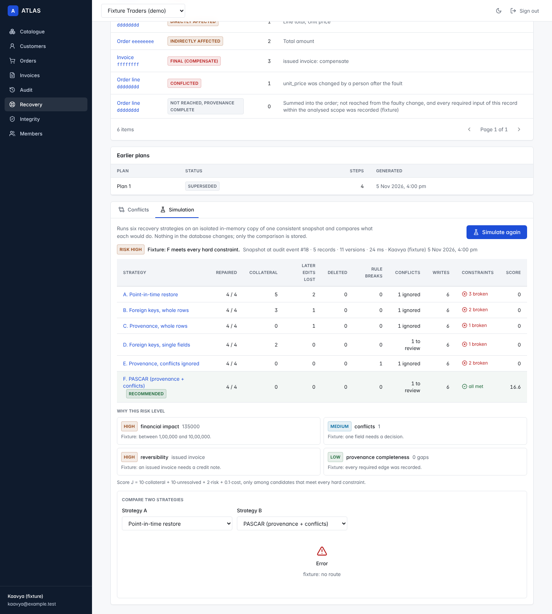 **Six strategies simulated on one snapshot** | 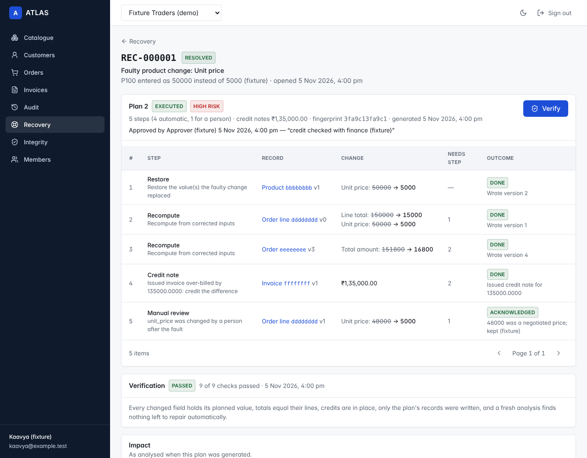 **Executed by a separate approver, then verified** |
| 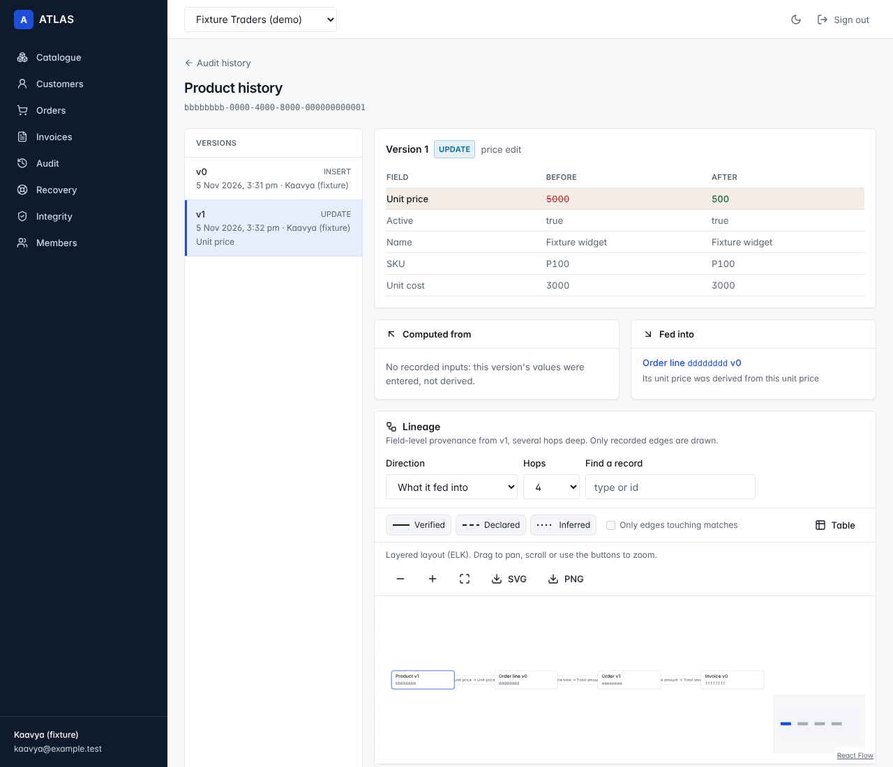 **Field-level lineage on React Flow + ELK** | 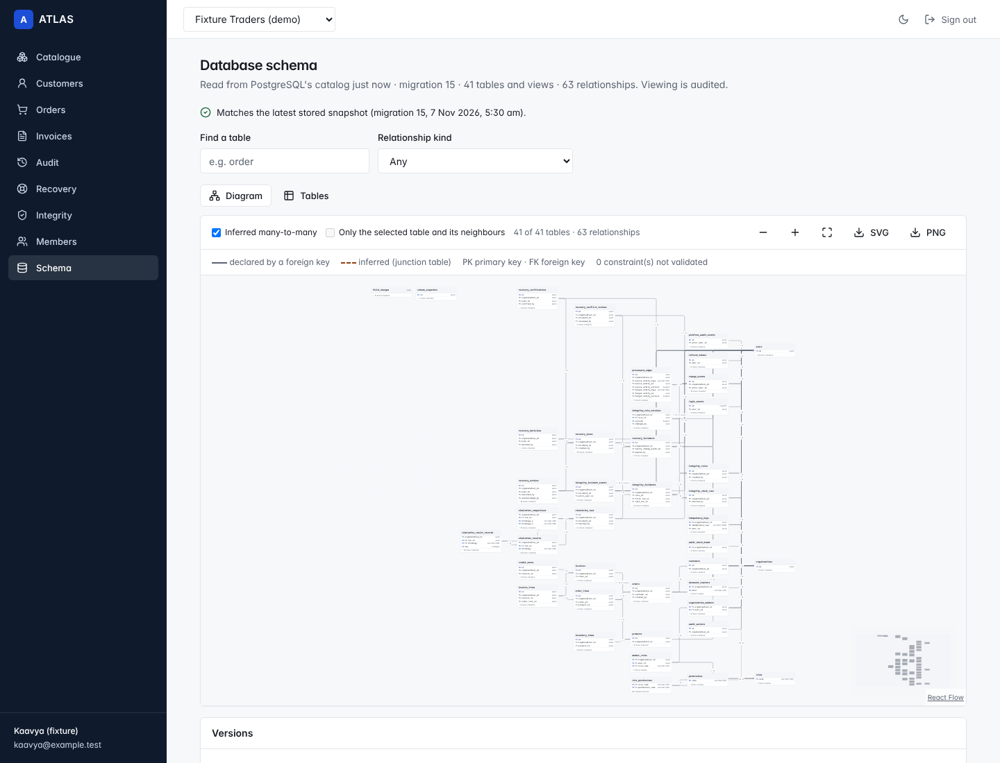 **Live ER diagram of the real schema (41 tables, 63 relationships)** |
| 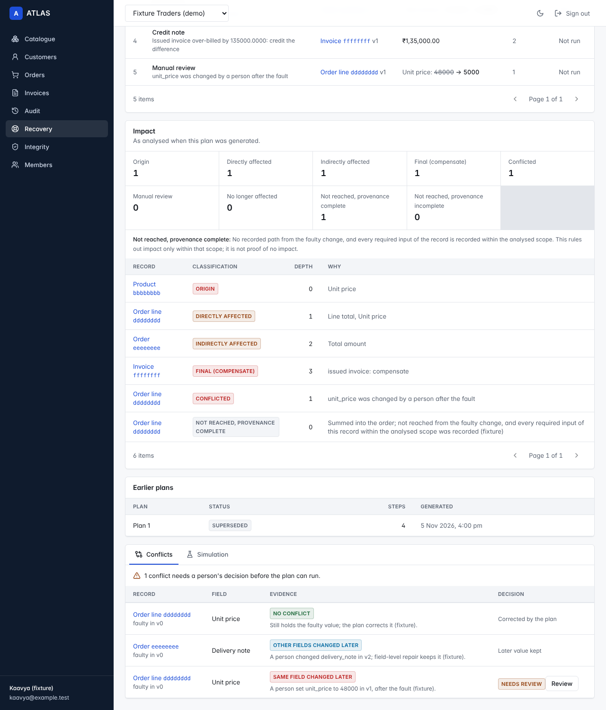 **Per-field conflicts waiting for a person** | 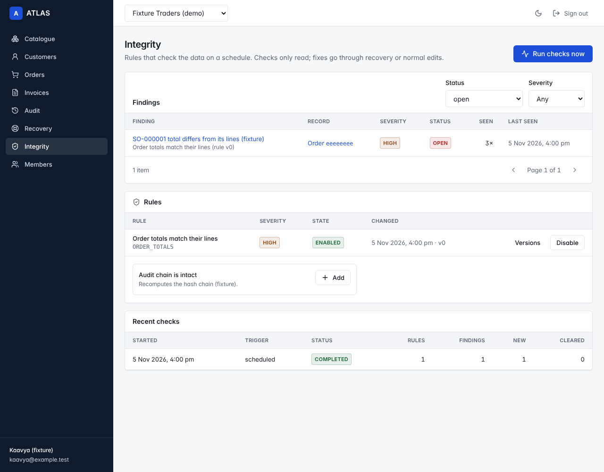 **Integrity monitoring** |

*UI screenshots are rendered against labelled fixture API responses (the ER diagram uses the real V1–V15
catalog); see [docs/ux/screenshots](docs/ux/screenshots/README.md). Light, dark and 390 px variants are there too.*

---

## How PASCAR recovery works

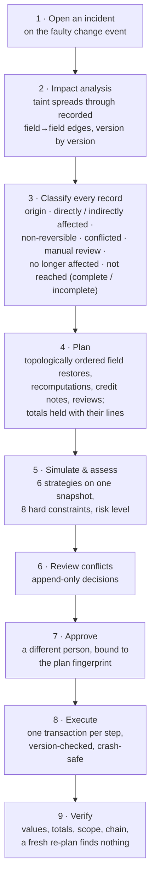

Design notes worth reading: [docs/algorithms/pascar.md](docs/algorithms/pascar.md) and
[ADR-0003: provenance at write time](docs/architecture/adr/0003-provenance-at-write-time.md).

**Why this is hard**
* **Foreign keys are not derivations.** Inventory references products but is valued at cost, so a price
  error never touches it — FK traversal would "fix" it anyway.
* **Some records can't be rolled back.** An issued invoice is final (the database enforces it), so
  recovery compensates with a credit note.
* **Later edits must survive.** Field-level repair keeps a delivery note edited after the mistake; a
  person who re-priced a line decides whether recovery may overwrite it.
* **History must be trustworthy.** Recovery itself is audited; nothing is ever deleted from the trail.

---

## Architecture

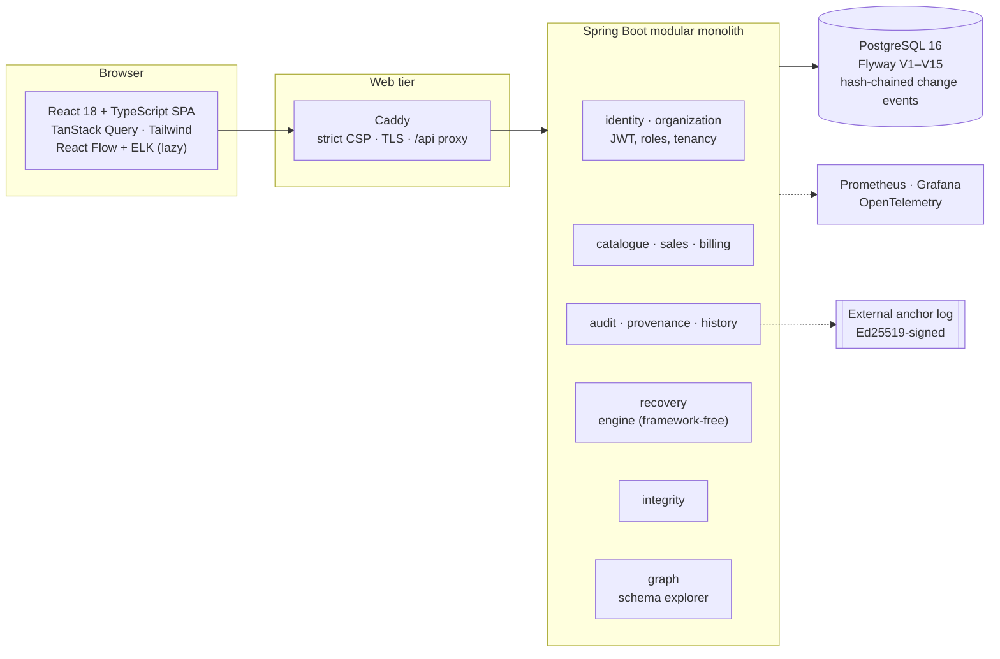

- **Modular monolith** with package-per-module boundaries; no microservices without a measured reason
  ([ADR-0001](docs/architecture/adr/0001-modular-monolith.md), [ADR-0006](docs/architecture/adr/0006-defer-infrastructure.md)).
- **JdbcClient over JPA** so every statement is explicit SQL that a harness can run against real PostgreSQL
  ([ADR-0007](docs/architecture/adr/0007-jdbc-over-jpa.md)).
- **Tenant isolation in the schema**: every foreign key between two tenant-owned tables is composite
  `(organization_id, …)`, so a row cannot point outside its tenant; the rest point at shared tables such as
  users and roles ([ADR-0004](docs/architecture/adr/0004-tenant-isolation.md)).
- **The recovery engine is framework-free Java**: analysis, planning, conflicts, simulation and the optimizer
  are plain classes tested in memory at 100k-order scale; Spring only adapts them to HTTP and SQL.
- **Server-side authorization only**: all 80 endpoints are checked by a static analyzer in CI; the UI hides
  actions but never decides.

---

## Tech stack

| Layer | Technology |
|---|---|
| Backend | Java 21, Spring Boot 3.5, Spring Security (JWT, refresh-token rotation with reuse detection), JdbcClient, Flyway, Micrometer, OpenTelemetry |
| Database | PostgreSQL 16 — triggers for append-only tables and hash chains, recursive CTEs for lineage, partial unique indexes |
| Frontend | React 18, TypeScript (strict), Vite, Tailwind, TanStack Query, React Flow 12.12.0, ELK.js, html-to-image |
| Testing | JUnit 5, Testcontainers, REST Assured, Vitest, Testing Library, Playwright + axe-core, Python SQL harnesses |
| Delivery | Docker Compose, Caddy, GitHub Actions (6 jobs), gitleaks, Trivy, ZAP, k6, Hadolint, Checkov |
| Cloud (written, not applied) | Terraform/OpenTofu for AWS: ECS Fargate, RDS, ALB + WAF, KMS, Secrets Manager, EFS anchor log with a locked backup vault, OIDC deploy role |

---

## Run it

**Prerequisites:** Docker Desktop and Python 3.

```bash
cp .env.example .env            # set ATLAS_DB_PASSWORD and ATLAS_JWT_SECRET (openssl rand -base64 48);
                                # for plain-HTTP localhost also set ATLAS_COOKIE_SECURE=false
docker compose --profile app up -d --build      # PostgreSQL + API + web tier → http://localhost:8088
```

<details>
<summary><b>Windows PowerShell: create the .env file</b></summary>

```powershell
$b = New-Object byte[] 48; [System.Security.Cryptography.RandomNumberGenerator]::Create().GetBytes($b)
$secret = [Convert]::ToBase64String($b)
@"
ATLAS_DB_USER=atlas
ATLAS_DB_PASSWORD=choose-a-local-password
ATLAS_JWT_SECRET=$secret
ATLAS_COOKIE_SECURE=false
ATLAS_RATELIMIT_APIPERMINUTE=100000
ATLAS_RATELIMIT_REGISTRATIONSPERHOUR=50
"@ | Set-Content -Encoding ascii .env
docker compose --profile app up -d --build
```
</details>

**Load the demo company** (synthetic, every name labelled "(demo)"):

```bash
python3 scripts/seed-demo.py --api http://127.0.0.1:8088 --yes-this-is-a-demo-environment \
    --credentials-out demo-credentials.txt --summary-out demo-summary.json
```

It creates *Demo Traders (synthetic demo data)* through the real API — four users with separate roles,
24 products, 40 customers, ~180 orders with invoices, two legitimate price changes and **one planted
mistake** (a ₹649 water bottle typed as ₹6,490) for you to recover. Passwords are random per run and written
only to the git-ignored credentials file. Use `127.0.0.1`, not `localhost`, on Windows.

**Unlock the ER diagram** (platform administrators only, by design):

```bash
docker compose exec postgres psql -U atlas -d atlas \
  -c "UPDATE users SET platform_admin = true WHERE email = '<the email you sign in with>';"
```

**A five-minute tour**
1. **Catalogue → the water bottle → History** — see the faulty version and, in the lineage graph, every order
   line, total and invoice it fed into. Click a node; expand two more hops.
2. **Audit → the price change → Open incident** — analyse impact, generate a plan, read each step's before → after.
3. **Simulation tab** — compare the six strategies; open one to see its records; compare any two.
4. **Sign in as the approver** (from the credentials file), approve, execute, verify. Credit notes appear on
   the issued invoices; delivery notes edited later are untouched.
5. **Integrity** — add rules, run checks. **Schema** — the live ER diagram; export it as SVG or PNG.

`--profile observability` adds Prometheus (alert rules with unit tests) and a Grafana dashboard on
http://localhost:3000. AWS deployment: [infra/terraform/README.md](infra/terraform/README.md).

**Tests**

```bash
cd backend && mvn verify                         # unit + Testcontainers integration tests + coverage gate
cd frontend && npm ci && npm test                # Vitest
# SQL harnesses against a local PostgreSQL (no JVM needed)
python3 -I scripts/verify-repository-sql.py && python3 -I scripts/verify-atlasx-sql.py && python3 -I scripts/verify-graph-sql.py
```

---

## What has been verified — and what has not

ATLAS keeps a strict status ledger in [docs/STATUS.md](docs/STATUS.md) (NOT STARTED → IMPLEMENTED → TESTED →
VERIFIED). This README never claims more than that file.

**Verified / tested**
- ✅ Schema V1–V15 applied to PostgreSQL 16 with assertion suites; the audit chain holds under 32 concurrent writers; tampering is detected.
- ✅ **Every SQL statement in the Java source** is extracted and executed against real tables by three harnesses: **175 + 106 + 30 checks**, including tenant isolation, append-only triggers and negative controls.
- ✅ **137 JUnit tests** for the domain, the PASCAR engine, the workflow (crash injected after every commit; 11/11 mutations caught), conflicts, simulation, optimizer and schema classification.
- ✅ **86 Vitest tests**; strict TypeScript; **axe-core: 0 violations over 34 rendered states** (light, dark, 390 px, dialogs); the production CSP enforced in Chromium with **0 violations**, including graph exports.
- ✅ **Authorization**: 80 endpoints, 0 problems, the committed permission table checked for drift.
- ✅ **First real run** on a Windows laptop with Docker Desktop: the backend builds, Flyway migrates, the app starts and serves the SPA; the demo seed made **1,032 API calls** with the audit chain intact over **1,661 events**.
- ✅ Infrastructure statically verified: `tofu validate`, Checkov **278 passed / 0 failed**, promtool, actionlint, hadolint, gitleaks clean over the full history.

**Not yet**
- ⏳ `mvn verify` — the Testcontainers integration suites (`RecoveryIT`, `AtlasXIT`, `GraphIT`, …) are written but have not run yet; the Spring wiring of recent modules is type-checked against API stubs only.
- ⏳ CI has not run (the repository has not been pushed), so k6 load tests, ZAP and Trivy scans have not run.
- ⏳ Nothing is deployed: there is no live URL.

---

## Engineering highlights

- **Honest evaluation**: every experiment compares against an *edge-independent oracle* and baseline
  strategies, publishes raw output, and states its limits.
- **Found its own bugs with measurement**: four performance or correctness defects above were discovered by the
  experiments, not by guessing.
- **Security by construction**: tenant-scoped composite keys, server-side permission checks, rate limits with a
  strict client-IP chain behind the proxy, refresh-token reuse detection, strict CSP, an open redirect found and
  fixed, secrets never committed (and scanned for).
- **Accessibility as a test**, not a promise: axe runs on every screenshot state; real issues it found (unnamed
  dialogs, low-contrast badges, mislabelled graph nodes) are fixed with regression tests.
- **No fake UI**: every button calls a real endpoint; every graph edge is a recorded edge; truncated record
  lists are labelled *partial*; inferred relationships are never drawn as declared.

---

## Repository

```
backend/            Spring Boot modular monolith
  src/main/java/com/atlas/
    identity  organization  catalogue  sales  billing  inventory
    audit  provenance  history  recovery (engine/, execution/)  integrity  graph  common
  src/main/resources/db/migration/     Flyway V1–V15
frontend/           React SPA · deploy/Caddyfile (production web tier) · e2e/ (Playwright, axe, CSP)
infra/terraform/    AWS: ECS Fargate, RDS, ALB + WAF, KMS, Secrets Manager, EFS anchor log
ops/                Prometheus config + alert rules (unit-tested), Grafana dashboard
scripts/            SQL harnesses, schema & concurrency checks, benchmarks, EXPLAIN, demo seed,
                    recovery smoke test, authorization check, anchoring end-to-end, web-tier check
docs/               architecture, ADRs, requirements, ER model, API, UX, security, experiments, status
.github/workflows/  CI (6 jobs) and a manual OIDC-based deploy
```

## Documentation

| Design | Evidence | Operations |
|---|---|---|
| [Architecture](docs/architecture/architecture.md) | [Status ledger](docs/STATUS.md) | [Deployment (AWS)](infra/terraform/README.md) |
| [PASCAR algorithm](docs/algorithms/pascar.md) | [Phase 5: impact analysis](docs/experiments/phase5-impact-analysis.md) | [Hardening](docs/security/hardening.md) |
| [ATLAS X plan](docs/architecture/atlas-x-integration-plan.md) | [Phase 7: PostgreSQL benchmark](docs/experiments/phase7-benchmark.md) | [Authentication](docs/security/authentication.md) |
| [Graph Intelligence](docs/architecture/graph-intelligence-assessment.md) | [ATLAS X: six strategies](docs/experiments/atlasx-milestone8.md) | [Endpoint permissions](docs/security/endpoint-permissions.md) |
| [Requirements (SRS)](docs/requirements/srs.md) · [ER model](docs/database/er-diagram.md) · [API](docs/api/api-contract-plan.md) | [Prior-art review](docs/research/prior-art.md) | [Spring Boot 4 plan](docs/architecture/spring-boot-4-migration.md) |
| [ADRs](docs/architecture/adr/) · [UX & design system](docs/ux/page-map-and-design-system.md) | [Roadmap](docs/roadmap.md) · [Risks & decisions](docs/risks-and-decisions.md) | |

## Prior art and honesty

Selective repair of databases is **not a new idea**: ATLAS builds on work such as Ammann et al. (2002),
Akkuş & Goel (2010), Retro and Warp (2010–2011), the provenance literature (Cheney, Chiticariu & Tan; W3C PROV),
SQL:2011 temporal tables and historical what-if queries (Mahif). ATLAS claims an **engineering combination,
evaluated honestly**, not a novel algorithm — see the [prior-art review](docs/research/prior-art.md).

No fabricated data, results or deployment claims. Demo and benchmark data are synthetic and labelled.

---

<div align="center">

Built by **Kaavya R** · B.Tech CSE (Data Science), VIT Vellore
[GitHub](https://github.com/kaavyaraja2006-create) · [LinkedIn](https://www.linkedin.com/in/kaavyar2006)

</div>
