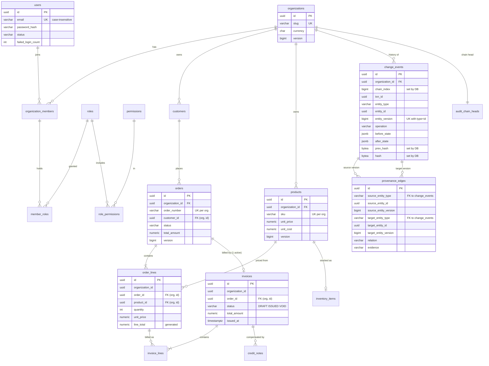

# ATLAS — Entity-Relationship Model

Tables marked **implemented** exist in Flyway migrations V1–V9 and are
covered by `schema-assertions.sql`. Tables marked **planned** are designs for
later phases and do not exist yet.

## Implemented (V1–V3)

## Implemented in V4 (Phase 2)

| Table | Purpose | Key constraints |
|---|---|---|
| `refresh_tokens` | Rotating refresh tokens, stored as SHA-256 only | 32-byte hash check; one live token per family; revocation needs a reason; `revoke_token_family()` |
| `login_events` | Login history and lockout evidence | Append-only; unknown-email attempts kept with null user |
| `idempotency_keys` | (org, key) → stored first response | PK per tenant; COMPLETED requires stored response |

## Implemented in V5 (Phase 2b)

| Change | Purpose |
|---|---|
| `document_counters` + `next_document_number(org, kind)` | Gapless per-organization SO/INV/CN numbers; a rollback releases the number |
| `order_lines.description` (NOT NULL) | What was sold, as shown to the customer, independent of later catalogue edits |
| `credit_notes.issued_at` + check | Issued credit notes are dated |
| `invoices` check replaced | Only ISSUED requires `issued_at`, so a mistaken DRAFT can be voided |

## Implemented in V6 (Phase 5)

| Table | Purpose | Key constraints |
|---|---|---|
| `recovery_incidents` | One faulty change event, title, reason, status | Tenant FK to `change_events (organization_id, id)`; one active incident per change; REC-numbered |
| `recovery_plans` | Immutable plan + impact JSON, fingerprint, risk, step counts | Trigger: content immutable, legal status transitions only, no delete; one PROPOSED per incident |

## Implemented in V7 (Phase 6)

| Table / change | Purpose | Key constraints |
|---|---|---|
| `recovery_plans` statuses | + EXECUTING, FAILED | Trigger: EXECUTED only via EXECUTING; PROPOSED → EXECUTING only without required approval; APPROVED only with a matching approval row; one EXECUTING per incident |
| `recovery_decisions` | Approvals and rejections | Trigger: author cannot approve, fingerprint must be the plan's; one approval per plan; rejection needs a reason; append-only |
| `recovery_actions` | One outcome per executed step, with its transaction id | UNIQUE (plan, step); inserted only while EXECUTING; DONE names its result; only AWAITING → ACKNOWLEDGED (with who, when, what) may change; no delete |
| `recovery_verifications` | Every verification run with its checks | Outcome must agree with counts (no PASSED with a failure or pending manual step); append-only |

## Implemented in V8–V9 (Phase 8)

| Table / change | Purpose | Key constraints |
|---|---|---|
| `ix_change_events_org_time_chain` | Audit list by time (replaces `ix_change_events_org_time`) | `(organization_id, occurred_at DESC, chain_index DESC)`, matches the list's ORDER BY |
| `ix_invoices_org_created` | Invoice list | `(organization_id, created_at DESC)` |
| `recompute_audit_chain()` | Recomputes the chain from event content between two trusted points | STABLE; reports last contiguous index, recomputed hash, first stored mismatch |
| `audit_anchors` | Local record of signed anchors published externally | UNIQUE (organization, chain_index); 32-byte hash; append-only trigger. Verification trusts the external copy, not this table |

## Implemented in V10–V13 (ATLAS X)

| Table / change | Purpose | Key constraints |
|---|---|---|
| `provenance_edges.operation` (V10) | The business operation that wrote the edge (`order.add_line`, `invoice.from_order`, `recovery.update_fields`) | Nullable for edges before V10; pattern check on new values |
| `field_changes` view (V10) | One row per changed field per version, over `change_events` | A view: the hash-chained events stay the single source |
| `orders.delivery_note` (V11) | An editable field after confirmation: a real legitimate later update to a different field | ≤ 500 characters; audited like every write |
| `recovery_conflict_reviews` (V11) | A person's decision on one field conflict of an incident | Append-only trigger; composite FK to the incident; the latest review per field counts |
| `simulation_runs`, `simulation_results` (V12) | One counterfactual simulation of an incident (snapshot chain index, fingerprint, assessment) and one row per strategy | One RUNNING run per incident (partial unique index); `repaired ≤ faulty`; results cascade with their run; retention job deletes old runs |
| `integrity_rules`, `integrity_rule_versions` (V13) | Monitoring rules and every version of their configuration | One rule per code per tenant; versions append-only |
| `integrity_check_runs` (V13) | One evaluation of the enabled rules (scheduled or manual) | Status and counts checked |
| `integrity_incidents`, `integrity_incident_events` (V13) | A finding per rule and subject, de-duplicated while open, with its status history | Partial unique index on open findings; events append-only |
| permissions `integrity.read`, `integrity.manage` (V13) | Granted to admin and operations manager (both); auditor and recovery approver (read) | — |

## Implemented in V14–V15 (Graph Intelligence)

| Table / change | Purpose | Key constraints |
|---|---|---|
| `platform_audit_events` (V14) | Platform-level audit (schema views, versions, diffs, exports, denials): the schema belongs to no tenant | Append-only trigger; actor must be a user; known actions only |
| `schema_snapshots` (V14) | One canonical catalog description per distinct structure, captured at start-up | Unique SHA-256; append-only |
| `simulation_results` + 9 columns (V15) | Exact record-level totals per strategy and whether its details were truncated | Totals and truncation consistent (check); rows immutable |
| `simulation_result_records` (V15) | Up to 5,000 record details per strategy: action, flags, field names, provenance path, conflict kind | Composite FKs to run (tenant) and result; a modified record must name its action; immutable; no values |
| `simulation_comparisons` (V15) | Immutable comparison of two strategies: exact counts, SHA-256, stored differences | Total = parts; stored ≤ total; truncated flag consistent; immutable |

## Planned

| Table | Phase | Purpose |
|---|---|---|
| `outbox_events` | deferred | Transactional outbox, polled publisher (ADR-0006) |

## Design notes

* **Composite tenant keys.** Every tenant table has `UNIQUE (organization_id, id)`;
  children reference `(organization_id, parent_id)`. A row can only point at a
  parent in the same tenant.
* **Snapshots, not a separate versions table.** `change_events` stores the
  full before/after state of each version (ADR-0005), so the state of any record
  at any version is one indexed lookup.
* **Generated totals.** `line_total` is `GENERATED ALWAYS AS (quantity * unit_price)`;
  it cannot drift from its inputs. Order and invoice totals are aggregates
  maintained by the application and checked as recovery invariants.
* **Money.** `numeric(19,4)` in the organization's currency; never floating point.
* **Normalisation.** 3NF, with two deliberate denormalisations: the
  `order_lines.unit_price` snapshot (business-required: an order keeps the
  price it was sold at) and stored aggregate totals (read performance; verified
  as invariants).
